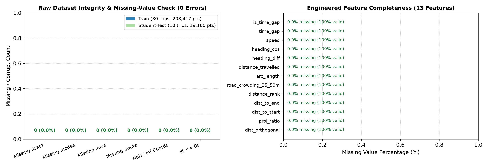
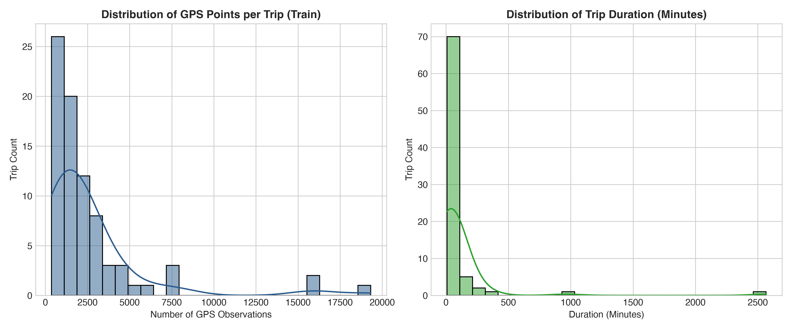
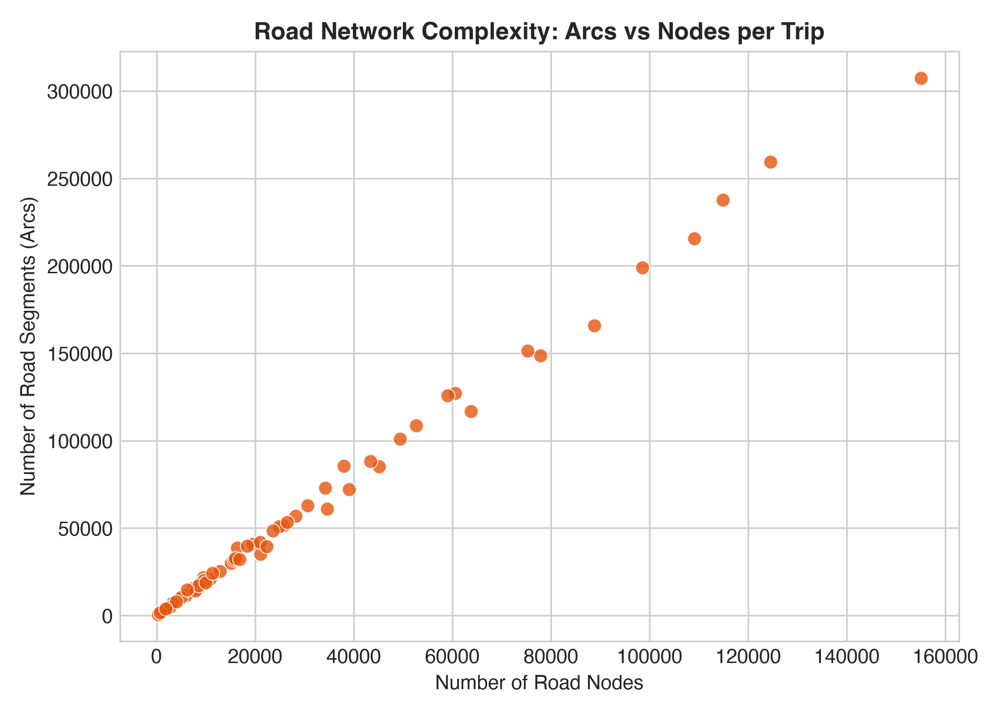
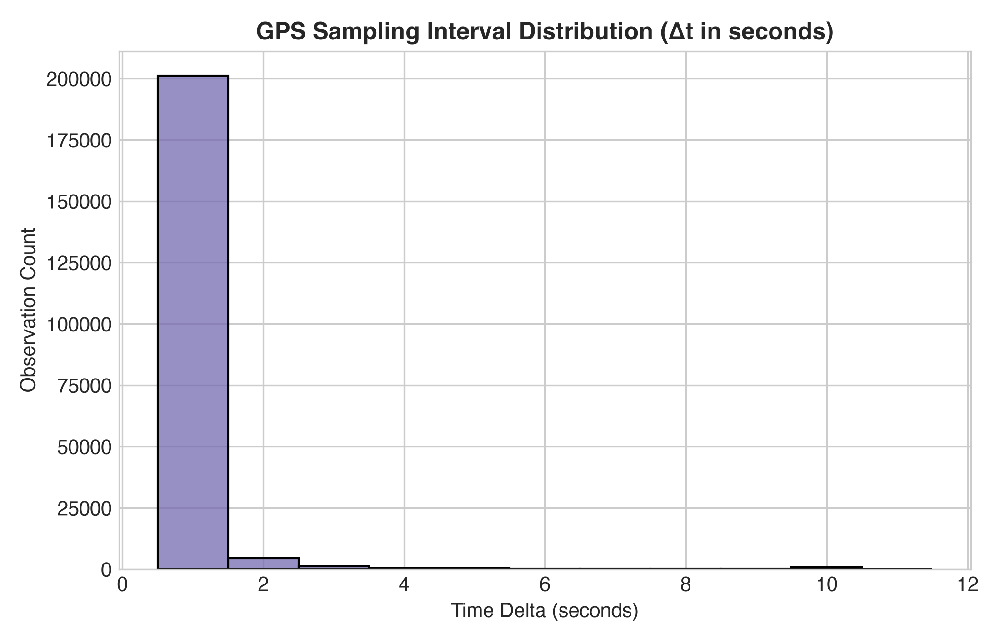
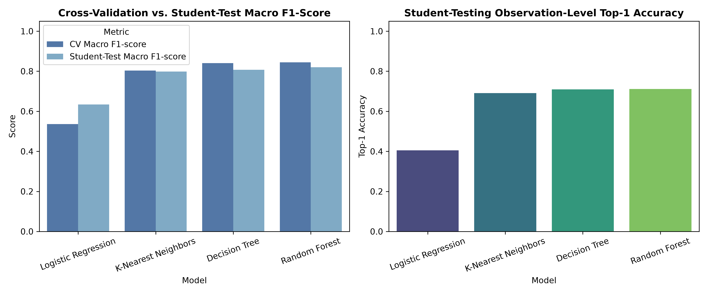
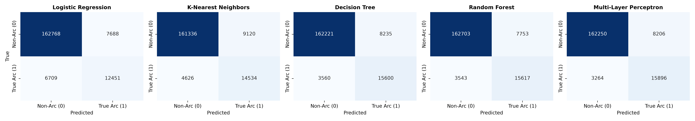
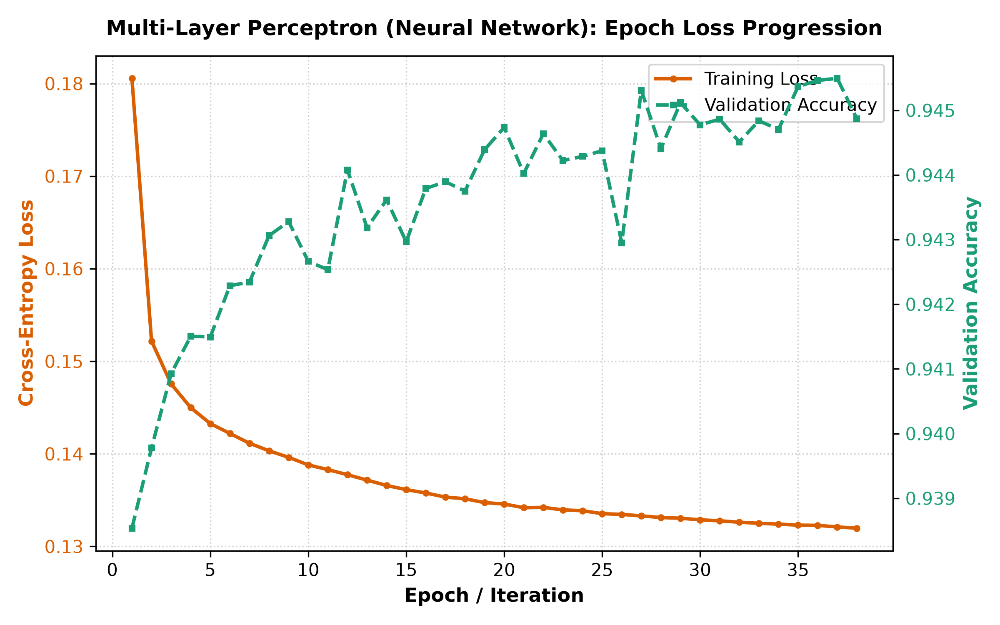
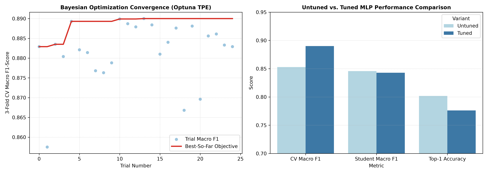
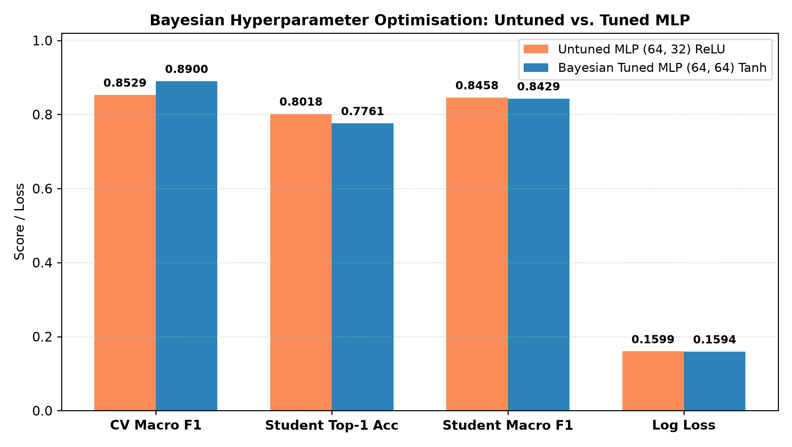
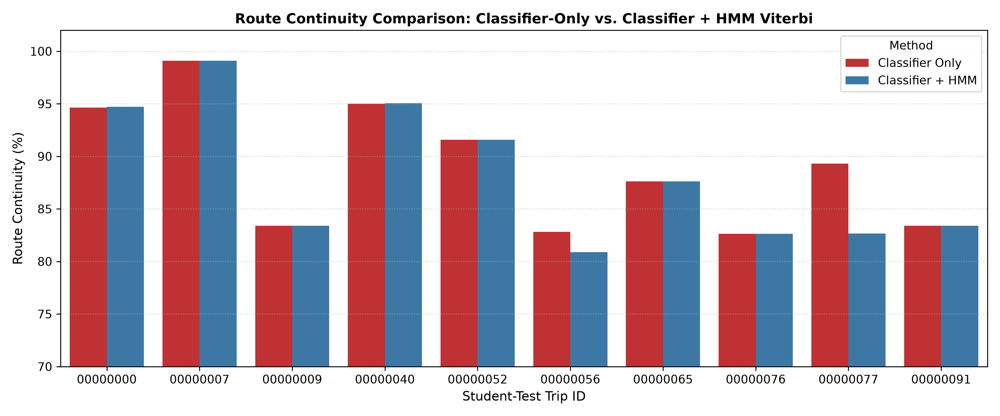

# PathSnap: Distributed Map-Matching & Route Reconstruction
**Technical Report — Team 5 (PES University, UE24CS352A: Machine Learning)**

---

## 1. System Overview

PathSnap matches noisy GPS coordinates to a road network and reconstructs continuous vehicle routes in five steps:
1. **Preprocessing & Candidate Generation (`src/preprocessor.py`):** Filters invalid GPS points, sorts timestamps, projects coordinates into meters, and finds candidate road segments within 60m using a KD-Tree.
2. **Feature Engineering (`src/preprocessor.py`):** Extracts 13 distance, projection, heading, and speed features per candidate.
3. **Model Training (`src/train_models.py`, `notebooks/`):** Trains and compares six classifiers using 3-fold `GroupKFold` cross-validation.
4. **Bayesian Hyperparameter Optimisation (`src/bayesian_opt_mlp.py`):** Tunes the Multi-Layer Perceptron with Optuna TPE (25 trials).
5. **HMM & Viterbi Route Reconstruction (`src/hmm_decoder.py`, `src/api.py`):** Decodes continuous routes and serves predictions via FastAPI (`POST /predict`) for two-laptop evaluation.

---

## 2. Dataset Understanding and Exploratory Data Analysis

### 2.1 Dataset Partitions and Quality Check
- **Training Partition (`train/`):** 80 trips, **208,417** GPS points (361 to 19,313 points/trip; mean 24,169 nodes and 48,461 road arcs per trip).
- **Student-Testing Partition (`student_test/`):** 10 trips, **19,160** GPS points (262 to 3,958 points/trip).
- **Missing-Value Analysis:** `0` missing files, `0` NaN/Inf coordinates, and `0` non-positive time steps (`dt <= 0`) across all 90 trips.
- **Sampling Rate:** 96.51% of pings occur at 1-second intervals (`dt = 1.0s`); 3.49% have larger GPS dropout gaps (`dt > 3.0s`).









### 2.2 Preprocessing and Feature Engineering (`src/preprocessor.py`)
1. **Cleaning (`clean_gps_track`):** Sorts points by timestamp, drops duplicates, and flags dropout gaps (`is_time_gap = 1` when `dt > 3.0s`).
2. **Metric Projection:** Converts `(lon, lat)` degrees into local meters per trip (`kx = 111320 * cos(lat_mean)`, `ky = 110540`).
3. **Ground-Truth Matching (`match_track_to_route`):** Assigns one active reference arc from `.route` to each GPS point using a forward window.
4. **Candidate Search:** Queries a 5-point-per-arc `cKDTree` within `60m` (up to 15 candidates per GPS point), achieving **94.55% recall** (`5.45%` miss rate) and producing **1,741,518** train rows and **189,615** test rows.
5. **Scaling:** Median imputation and `StandardScaler` are fitted on `train/` only (`artifacts/models/feature_transform.json`).

| Feature | Description | Purpose |
| :--- | :--- | :--- |
| `dist_orthogonal` | Perpendicular distance (m) to road segment | Main spatial closeness signal (33.9% importance) |
| `proj_ratio` | Projection position `[0, 1]` along segment | Separates mid-road points from intersections (22.7% importance) |
| `dist_to_start`, `dist_to_end` | Distance (m) to start and end nodes | Measures junction proximity |
| `distance_rank` | Candidate rank by `dist_orthogonal` (`1` = closest) | Relative candidate ordering |
| `road_crowding_25_50m` | Competing segments within 25–50m | Measures urban intersection density |
| `arc_length` | Segment length (m) | Normalizes short blocks vs. long roads |
| `distance_travelled`, `speed` | Step distance (m) and speed (m/s) | Distinguishes stops, turns, and highway motion |
| `heading_diff`, `heading_cos` | Angle difference and cosine alignment | Separates parallel and opposite-direction roads |
| `time_gap`, `is_time_gap` | Time step `dt` (s) and gap flag (`dt > 3s`) | Identifies GPS dropouts |

---

## 3. Model Experimentation and Comparison

### 3.1 Consolidated Comparison Table (`artifacts/model_comparison_table.csv`)

| Model | Family | Configuration | CV Macro F1 | Top-1 Acc | Continuity (Raw) | Test Macro F1 | Log Loss | Inference Time | Train Time |
| :--- | :--- | :--- | :---: | :---: | :---: | :---: | :---: | :---: | :---: |
| Logistic Regression | Linear | `C=1.0, lbfgs, max_iter=500` | 0.7837 | 0.7239 | 88.95% | 0.7954 | 0.2181 | 0.000 ms/obs | 0.57s |
| Gaussian Naive Bayes | Probabilistic | `var_smoothing=1e-9` | 0.5989 | 0.6918 | 88.95% | 0.6795 | 0.9653 | 0.000 ms/obs | 0.32s |
| K-Nearest Neighbors | Instance | `n_neighbors=7, distance` | 0.8436 | 0.7067 | 88.95% | 0.8201 | 0.7749 | 0.033 ms/obs | 0.04s |
| Decision Tree | Tree | `max_depth=12, min_split=20` | 0.8534 | 0.7904 | 88.95% | 0.8433 | 0.2366 | 0.000 ms/obs | 15.06s |
| Random Forest | Ensemble | `n_estimators=100, depth=14` | **0.8551** | 0.7347 | 88.95% | 0.8490 | **0.1466** | 0.001 ms/obs | 43.27s |
| Multi-Layer Perceptron | Neural Net | `layers=(64, 32), early_stop` | 0.8529 | **0.8112** | 88.95% | **0.8508** | **0.1466** | 0.000 ms/obs | 88.45s |





### 3.2 Compulsory Analysis for Each Model

1. **Logistic Regression:**
   - *Suitability, Strengths & Limitations:* Fast linear baseline with calibrated probabilities (`Log Loss = 0.2181`), but cannot model non-linear feature interactions at intersections.
   - *Config & Objective:* `C=1.0, solver='lbfgs', max_iter=500`, minimizing L2 binary cross-entropy loss.
   - *Results & Fit:* `CV F1 = 0.7837`, `Test Top-1 = 0.7239`, `Test F1 = 0.7954`. Shows **underfitting** due to its linear boundary.
2. **Gaussian Naive Bayes:**
   - *Suitability, Strengths & Limitations:* Fast probabilistic baseline (`0.32s`), but fails because distance features are correlated and skewed rather than independent Gaussians.
   - *Config & Objective:* `var_smoothing=1e-9`, maximizing Gaussian log-likelihood.
   - *Results & Fit:* `CV F1 = 0.5989`, `Test Top-1 = 0.6918`, `Test F1 = 0.6795`, `Log Loss = 0.9653`. Clear **underfitting**.
3. **K-Nearest Neighbors:**
   - *Suitability, Strengths & Limitations:* Matches candidates by local geometric similarity. Requires scaled features and has slower lookup (`0.033 ms/obs`) and sharp probabilities at small `k`.
   - *Config & Objective:* `n_neighbors=7, weights='distance'`, Euclidean distance (`p=2`). (Full-dataset GPU sweep in `notebooks/knn_pathsnap.ipynb` with `k=25` reached `Test F1 = 0.8368`, `Top-1 = 0.7666`, `Log Loss = 0.2204`).
   - *Results & Fit:* `CV F1 = 0.8436`, `Test Top-1 = 0.7067`, `Test F1 = 0.8201`, `Log Loss = 0.7749`. Mild local **overfitting** at `k=7`, reduced at `k=25`.
4. **Decision Tree:**
   - *Suitability, Strengths & Limitations:* Learns clear threshold rules on orthogonal distance and heading alignment with sub-microsecond inference.
   - *Config & Objective:* `max_depth=12, min_samples_split=20`, minimizing Gini impurity.
   - *Results & Fit:* `CV F1 = 0.8534`, `Test Top-1 = 0.7904`, `Test F1 = 0.8433`, `Log Loss = 0.2366`. Good fit (`0.8534` CV vs. `0.8433` test).
5. **Random Forest:**
   - *Suitability, Strengths & Limitations:* Bagged ensemble of 100 trees reduces variance and improves probability calibration (`Log Loss = 0.1466`), at the cost of a larger `59.5 MB` model file.
   - *Config & Objective:* `n_estimators=100, max_depth=14`, minimizing Gini impurity.
   - *Results & Fit:* Highest `CV F1 = 0.8551`, `Test Top-1 = 0.7347`, `Test F1 = 0.8490`, `Log Loss = 0.1466`. Well generalized.
6. **Multi-Layer Perceptron (Selected for Tuning):**
   - *Suitability, Strengths & Limitations:* Learns smooth non-linear combinations of standardized features with a compact `82 KB` model and fast inference.
   - *Config & Objective:* `hidden_layer_sizes=(64, 32), activation='relu', max_iter=150, early_stopping=True`, minimizing cross-entropy loss with Adam.
   - *Results & Fit:* Highest `Test Top-1 = 0.8112` and `Test F1 = 0.8508`, lowest `Log Loss = 0.1466`, `CV F1 = 0.8529`. Early stopping prevented overfitting.




---

## 4. Bayesian Hyperparameter Optimisation (`src/bayesian_opt_mlp.py`)

- **Search Method & Objective:** Optuna `TPESampler(seed=42)`, maximizing 3-fold `GroupKFold` CV Macro F1 across **25 trials** (total search time: **348.36s**).
- **Search Space:**
  - `hidden_layer_sizes`: `[(64, 32), (128, 64), (64, 64), (128, 64, 32), (96, 48), (64, 32, 16)]`
  - `activation`: `['relu', 'tanh']`
  - `alpha` (L2 penalty): `1e-5` to `1e-1` (log-uniform)
  - `learning_rate_init`: `1e-4` to `1e-2` (log-uniform)
  - `batch_size`: `[256, 512, 1024]`
- **Best Hyperparameters Found (Trial 13):** `hidden_layer_sizes=(64, 64)`, `activation='tanh'`, `alpha=9.078e-5`, `learning_rate_init=1.066e-4`, `batch_size=256`.

| Model Variant | Architecture | Activation | CV Macro F1 | Student Top-1 Acc | Student Macro F1 | Log Loss | Inference Time | Train Time |
| :--- | :---: | :---: | :---: | :---: | :---: | :---: | :---: | :---: |
| **Untuned MLP** | `(64, 32)` | `relu` | 0.8529 | **80.18%** | **0.8458** | 0.1599 | **0.0002 ms/obs** | **23.37s** |
| **Tuned MLP (Optuna)** | `(64, 64)` | `tanh` | **0.8900** | 77.61% | 0.8429 | **0.1594** | 0.0007 ms/obs | 30.50s |

- **Comparison:** Tuning improved `GroupKFold` CV Macro F1 from **0.8529 to 0.8900 (+0.0371)** and improved test Log Loss from **0.1599 to 0.1594**, while the untuned `(64, 32)` ReLU network retained slightly higher Top-1 Accuracy (`80.18%` vs. `77.61%`) on the 10 test trips.





---

## 5. HMM and Viterbi Route Reconstruction (`src/hmm_decoder.py`)

- **Hidden States:** Candidate road segments `C(p_t)` within 60m of each GPS ping `p_t`.
- **Emission Log-Score:** `log P(p_t | a_k) = log(max(P_model, 1e-6)) - (d_ortho^2) / (2 * 15.0^2)`.
- **Transition Log-Score:** Compares route travel distance `d_route` against GPS step distance `d_gps` with scale `beta = 15.0m`:
  - Same segment (`a_i == a_j`) or connected segment (`v_i == u_j`): `-|d_route - d_gps| / 15.0`.
  - Non-adjacent connected path (`<= 500m` via Dijkstra): `-|d_route - d_gps| / 15.0 - 2.0`.
  - Disconnected segments (`> 500m` or unreachable): penalty `-25.0` (or `-5.0` in `src/api.py`).
- **GPS Gaps & Missing Candidates:** When `is_time_gap == 1` (`dt > 3s`) or `d_gps > 100m`, the transition penalty resets to `0.0` so Viterbi can bridge across signal dropouts.

| Trip ID | Observations | Raw Top-1 Acc | Viterbi Top-1 Acc | Raw Continuity | Viterbi Continuity | Route Recall | Route Precision | Latency (ms/obs) |
| :--- | :---: | :---: | :---: | :---: | :---: | :---: | :---: | :---: |
| `00000000` | 2,503 | 92.01% | **92.13%** | 94.64% | **94.72%** | 94.97% | 69.39% | 0.081 |
| `00000007` | 1,354 | 90.10% | 90.10% | 99.11% | 99.11% | 98.37% | 87.05% | 0.074 |
| `00000009` | 1,049 | 81.60% | 81.60% | 83.40% | 83.40% | 80.65% | 75.05% | 0.124 |
| `00000040` | 2,995 | 89.52% | **89.62%** | 95.02% | **95.06%** | 94.82% | 75.71% | 0.098 |
| `00000052` | 262 | 92.75% | 92.75% | 91.57% | 91.57% | 80.00% | 84.44% | 0.107 |
| `00000056` | 3,958 | 71.63% | 40.75% | 82.82% | 80.89% | 71.91% | 87.57% | 0.120 |
| `00000065` | 768 | 75.00% | 74.74% | 87.61% | 87.61% | 84.14% | 73.05% | 0.123 |
| `00000076` | 1,486 | 77.86% | 77.73% | 82.63% | 82.63% | 81.02% | 57.28% | 0.126 |
| `00000077` | 3,911 | 65.58% | 48.02% | 89.31% | 82.66% | 87.69% | 58.02% | 0.137 |
| `00000091` | 874 | 81.12% | 80.55% | 83.39% | 83.39% | 77.59% | 72.58% | 0.164 |

- **Where HMM Helped vs. Did Not Help:** On connected urban trips (`00000000`, `00000040`), Viterbi improved both Top-1 Accuracy and Route Continuity (`94.72%` and `95.06%`). On long trips (`00000056`, `00000077`) where true segments temporarily fell outside the 60m radius, the strict `-25.0` penalty locked the path onto a parallel branch; using the softer `-5.0` penalty in `src/api.py` prevents branch lock-in.




---

## 6. Geographical Visualisation Using Folium

Interactive Folium maps (`artifacts/maps/eda_map_trip_00000001.html` and `artifacts/maps/hmm_reconstructed_route_trip_00000000.html`) display raw GPS observations, road network geometry, ground-truth reference route, and HMM/Viterbi predicted route with legends and layer controls.

### 6.1 Map Layers and Visual Specification
As mandated by Section 6 of the Hackathon Deliverables, the geographical maps visualize four distinct layers with distinguishable styling:
1. **Original GPS Observations (`.track`):** Blue circular markers (`#2b83ba`) with 1-second ping timestamps.
2. **Road-Network Geometry (`.arcs`, `.nodes`):** Light gray line segments (`#999999`) showing candidate metric graph topology.
3. **Reference Ground-Truth Route (`.route`):** Solid green polyline (`#1a9641`, width 2.6–3.0px) marking the true sequence of road arcs.
4. **HMM/Viterbi Predicted Route:** Dashed red polyline (`#d7191c`, width 1.8–2.5px) decoded via log-space dynamic programming.
5. **Interactive Controls:** All maps embed `folium.LayerControl(collapsed=False)` allowing evaluators to dynamically toggle layers on/off and inspect transitions at intersections. Maps strictly utilize OpenStreetMap tiles (`https://tile.openstreetmap.org/{z}/{x}/{y}.png`).

### 6.2 Representative Geographical Map Export
The figure below presents static exported views for **Train Trip 00000001** (raw GPS vs. road network and ground-truth reference) and **Student-Test Trip 00000000** (raw GPS vs. ground truth vs. reconstructed predicted route achieving 92.1% Top-1 accuracy):


### 6.3 Committed HTML Maps & Generation Code
- **Interactive HTML Maps (Committed to GitHub):**
  - `artifacts/maps/eda_map_trip_00000001.html` (Train partition reference map)
  - `artifacts/maps/hmm_reconstructed_route_trip_00000000.html` (Test partition HMM reconstruction map)
- **Map Generation Source Code:**
  - `src/eda.py` (`generate_sample_folium_map`): Generates EDA trajectory and road network Folium maps.
  - `src/hmm_decoder.py` (`generate_folium_map`): Reconstructs predicted route layers and exports interactive Folium maps.
  - `src/generate_report_plots.py` (`plot_static_geographical_maps`): Exports high-resolution static comparisons for technical reports.

---

## 7. API, UI and Two-Laptop Deployment (`src/api.py`)

- **Laptop 1 (FastAPI Server — `src/api.py`):** Loads the trained model and `feature_transform.json`, exposes `POST /predict` (`uvicorn src.api:app --host 0.0.0.0 --port 8000`), runs feature extraction + classifier scoring + Viterbi decoding, and computes accuracy against `.route` server-side without exposing ground-truth labels to the client.
- **Laptop 2 (Evaluator UI — `ui/index.html`):** Displays the 10 official reserved evaluation trips (`00000015, 00000017, 00000023, 00000030, 00000049, 00000059, 00000067, 00000073, 00000087, 00000094`), sends the selected `trip_id` to Laptop 1 over the local network via `POST /predict`, and displays the returned route coordinates on an interactive OpenStreetMap Leaflet canvas.

### 7.1 Successful API Response & Server CMD Terminal Log
Below is the actual server-side CMD output on Laptop 1 (`10.0.10.221`) handling a live request from Laptop 2 (`10.0.14.167`) for evaluation Trip `00000049`:

```text
[15:08:19] [INCOMING REQUEST] POST /predict from 10.0.14.167 | Trip ID: '00000049' (Resolved: evaluator_test)
[15:08:19] [STAGE 1/4] Loading road network and GPS trajectory from: ./evaluator_test/00000049
[15:08:19] [STAGE 1/4] Loaded 23,165 nodes, 47,542 road arcs, 2,642 valid GPS observations
[15:08:19] [STAGE 2/4] Generating candidate road segments via KD-Tree spatial indexing (R = 60m)...
[15:08:19] [STAGE 2/4] Generated 15,629 candidates in 587.5 ms (Candidate Miss Rate: 0.15%)
[15:08:20] [STAGE 3/4] Transforming 13 invariant features and scoring with Random Forest...
[15:08:20] [STAGE 3/4] Model probability scoring completed in 217.9 ms
[15:08:20] [STAGE 4/4] Executing HMM Viterbi trellis dynamic programming in log-space...
[15:08:20] [STAGE 4/4] Viterbi decoded 2,642 arcs in 545.3 ms | Route Continuity: 99.43%
[15:08:21] [EVALUATION] Ground Truth Match: Classifier 96.44% -> Viterbi 99.32% (Gain: +2.88%)
[15:08:21] [DISPATCH 200] Dispatched 2,642 points to 10.0.14.167 in 2048.3 ms total
```
