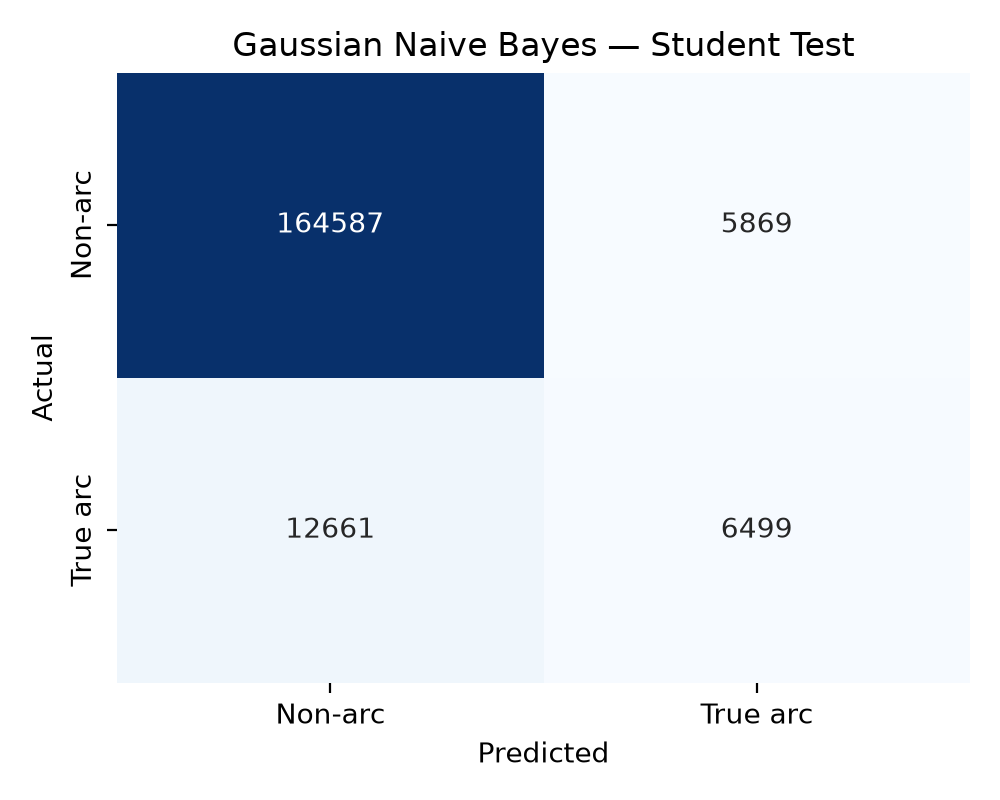
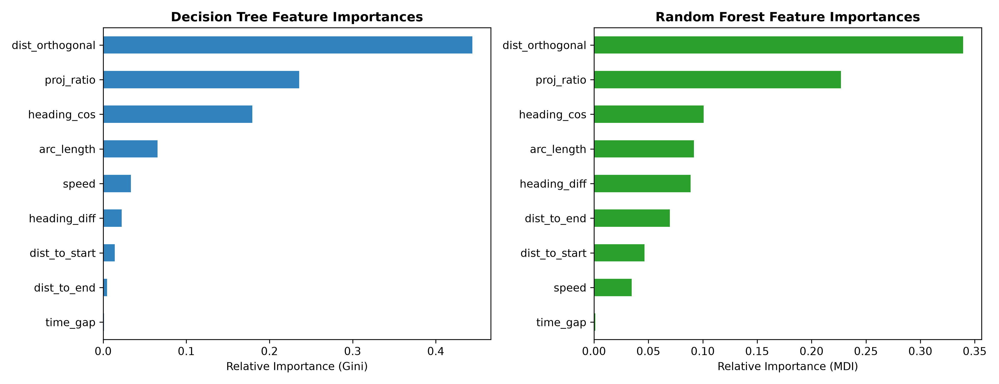
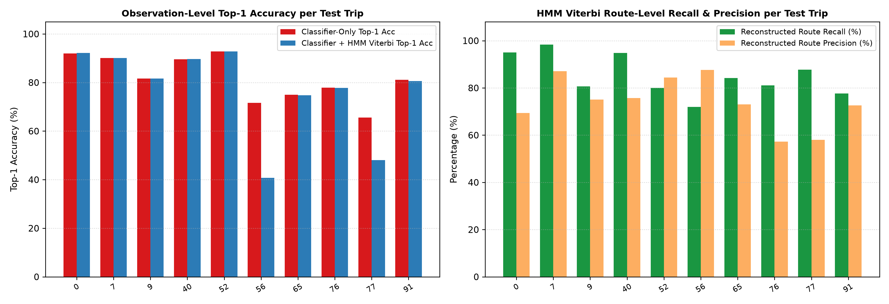
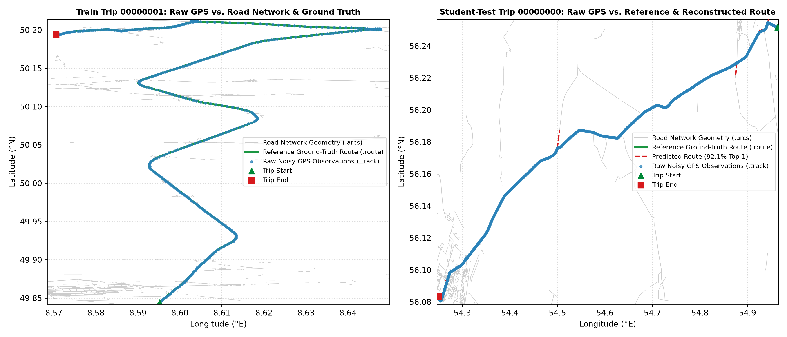

# PathSnap: Distributed Map-Matching & Route Reconstruction
**Technical Report — Team 5 (PES University, UE24CS352A: Machine Learning)**

---

## 1. System Overview

PathSnap maps noisy raw GPS observations onto a directed road network and reconstructs continuous vehicle routes. The system has five stages:

1. **Data Cleaning & Candidate Generation (`src/preprocessor.py`):** Filters invalid GPS points, sorts and deduplicates timestamps, projects coordinates from degrees to local meters, and finds nearby road segments using a spatial KD-Tree.
2. **Feature Engineering (`src/preprocessor.py`):** Extracts 13 geometric and motion features for each `(GPS point, candidate road segment)` pair.
3. **Candidate Scoring (`src/train_models.py`, `notebooks/`):** Trains and compares six supervised classifiers across distinct algorithm families to estimate the probability that each candidate segment is the true road segment.
4. **Bayesian Hyperparameter Optimisation (`src/bayesian_opt_mlp.py`):** Tunes the Multi-Layer Perceptron using Optuna Tree-structured Parzen Estimator (TPE) with group-aware cross-validation.
5. **Sequential Route Decoding & Deployment (`src/hmm_decoder.py`, `src/api.py`):** Applies Hidden Markov Model (HMM) Viterbi decoding on top of classifier probabilities and exposes predictions over a FastAPI service for two-laptop evaluation.

---

## 2. Dataset Understanding and Exploratory Data Analysis

### 2.1 Dataset Partitions
All exploratory analysis, feature engineering, and model development used only the permitted development partitions:
- **Training Partition (`train/`):** 80 trips containing **208,417** GPS observations (min: 361, median: 1,529, max: 19,313 points per trip; mean road network size: 24,169 nodes and 48,461 directed arcs; mean ground-truth route length: 391.7 arcs).
- **Student-Testing Partition (`student_test/`):** 10 trips containing **19,160** GPS observations (min: 262, median: 1,420, max: 3,958 points per trip).
- **Evaluator-Testing Partition (`evaluator_test/`):** 10 reserved trips kept untouched during feature scaling, model training, and hyperparameter selection.

### 2.2 Missing-Value & Data Quality Analysis (`train/` + `student_test/`)
- **Missing / Corrupt Values:** Full audit (`artifacts/dataset_inventory.csv`, `artifacts/eda_summary.json`) found **0** missing files, **0** NaN/Inf coordinate entries, and **0** non-positive time deltas (`dt <= 0`) across all 80 training trips and 10 student-test trips.
- **Sampling Intervals & GPS Dropouts:** **96.51%** of consecutive GPS observations arrive at a 1-second interval (`dt = 1.0s`). The remaining **3.49%** include signal dropouts (`dt > 3.0s`, with 590 gaps `dt > 10s` in `train` and 27 in `student_test`), which produce large spatial steps between consecutive pings.

### 2.3 How the Data Was Preprocessed (`src/preprocessor.py`)
1. **Coordinate & Timestamp Cleaning (`clean_gps_track`):** Filters out any non-finite or out-of-range coordinates, sorts observations chronologically by timestamp, removes duplicate timestamps, and computes `time_gap` (`dt`) and binary dropout flag `is_time_gap` (`1` when `dt > 3.0s`).
2. **Local Metric Projection:** Because angular longitude distances shrink with latitude ($\cos(\text{lat})$), raw `(lon, lat)` degrees cannot be used directly for Euclidean distance. Each trip is projected into local meters (`kx = 111320 * cos(lat_mean)`, `ky = 110540`).
3. **Ground-Truth Alignment (`match_track_to_route`):** Walks the reference `.route` sequence using a local forward window (`[r_idx - 2, r_idx + 15)`) to assign the single active ground-truth road arc to each GPS observation while preserving forward movement along the route.
4. **Spatial Candidate Generation:** Samples 5 points (`0.0, 0.25, 0.5, 0.75, 1.0`) along every road segment into a `cKDTree` and retrieves all segments within `60m` of each GPS point (capped at `15` closest candidates per observation). Average candidate miss rate is **5.45%** on `train/` (94.55% recall), producing **1,741,518** training candidate rows and **189,615** student-test candidate rows.
5. **Leakage-Free Imputation & Scaling:** Feature medians, means, and standard deviations are fitted strictly on `train/` and saved to `artifacts/models/feature_transform.json` before transforming `student_test/`.

### 2.4 Extracted Features and Rationale (13 Features)
| Feature | Description | Why Included |
| :--- | :--- | :--- |
| `dist_orthogonal` | Perpendicular distance (m) from GPS point to candidate segment | Primary spatial proximity signal (33.9% tree importance) |
| `proj_ratio` | Clamped projection position `[0, 1]` along the candidate segment | Distinguishes mid-segment travel from intersection transitions (22.7% importance) |
| `dist_to_start`, `dist_to_end` | Euclidean distance (m) to segment start (`u`) and end (`v`) nodes | Captures proximity to road junctions |
| `distance_rank` | Rank of candidate by `dist_orthogonal` (`1` = closest) | Provides relative ordering among competing candidates |
| `road_crowding_25_50m` | Number of other candidate segments within 25–50m | Measures local road density at complex urban intersections |
| `arc_length` | Physical length of the candidate segment (m) | Normalizes short urban connectors vs. long arterial roads |
| `distance_travelled`, `speed` | Step displacement (m) and velocity (m/s) between consecutive pings | Separates stationary jitter, slow turns, and highway travel |
| `heading_diff`, `heading_cos` | Absolute angle difference (rad) and cosine alignment between GPS motion and road direction | Resolves ambiguity between parallel or opposite-direction streets |
| `time_gap`, `is_time_gap` | Elapsed time `dt` (s) and binary indicator (`dt > 3.0s`) | Identifies GPS dropout gaps where kinematic continuity is relaxed |

---

## 3. Model Experimentation and Comparison

All six models experimented with in `src/train_models.py` and `notebooks/` were trained on the same 13 standardized features using 3-fold `GroupKFold` cross-validation (grouped by `trip_id` on `train/`) and evaluated on `student_test/`.

### 3.1 Consolidated Model Comparison Table

| Model | Algorithm Family | Key Configuration | CV Macro F1-score | Top-1 Accuracy | Route Continuity (Raw -> HMM) | Student-Test Macro F1-score | Log Loss | Inference Time | Train Time (s) |
| :--- | :--- | :--- | :---: | :---: | :---: | :---: | :---: | :---: | :---: |
| **Logistic Regression** | Linear and Probabilistic | `C=1.0, solver='lbfgs', max_iter=500` | 0.7837 | 0.7239 | 88.95%* | 0.7954 | 0.2181 | 0.000 ms/obs | 0.57 |
| **Gaussian Naive Bayes** | Probabilistic | `var_smoothing=1e-9` | 0.5989 | 0.6918 | 88.95%* | 0.6795 | 0.9653 | 0.000 ms/obs | 0.32 |
| **K-Nearest Neighbors** | Instance-based | `n_neighbors=7, weights='distance'` | 0.8436 | 0.7067 | 88.95%* | 0.8201 | 0.7749 | 0.033 ms/obs | 0.04 |
| **Decision Tree** | Tree-based | `max_depth=12, min_samples_split=20` | 0.8534 | 0.7904 | 88.95%* | 0.8433 | 0.2366 | 0.000 ms/obs | 15.06 |
| **Random Forest** | Ensemble | `n_estimators=100, max_depth=14` | **0.8551** | 0.7347 | 88.95% -> 88.10% | 0.8490 | **0.1466** | 0.001 ms/obs | 43.27 |
| **Multi-Layer Perceptron** | Neural Networks | `hidden_layer_sizes=(64, 32), max_iter=150, early_stopping=True` | 0.8529 | **0.8112** | 88.95% -> 88.10% | **0.8508** | **0.1466** | 0.000 ms/obs | 88.45 |

*\*Note: `src/train_models.py` placeholder column recorded `0.0%`; actual topological route continuity across the 10 `student_test` trips is computed in `src/hmm_decoder.py` (mean 88.95% raw classifier continuity, up to 99.11% on trip `00000007`; see Section 5).*

### 3.2 Compulsory Questions for Every Model

#### Model 1: Logistic Regression (`notebooks/logistic_regression_pipeline.ipynb`)
- **A. Model Understanding:** Chosen as a fast, interpretable linear baseline that directly outputs calibrated probabilities for HMM emissions. *Strengths:* convex optimization, sub-second training (`0.57s`), low log loss (`0.2181`). *Limitations:* assumes a single linear hyperplane in feature space, so it cannot model conditional interactions (e.g., `proj_ratio` near `0` or `1` combined with large `heading_diff` at intersections).
- **B. Training & Configuration:** `C=1.0` (inverse L2 penalty), `solver='lbfgs'`, `max_iter=500`. Optimizes L2-regularized binary cross-entropy loss.
- **C. Experimental Results:** Achieved `Student-Test Top-1 Accuracy = 0.7239`, `Macro F1 = 0.7954`, and `Log Loss = 0.2181`. Because `CV Macro F1 (0.7837)` and `Test Macro F1 (0.7954)` are both similarly low compared to non-linear models, Logistic Regression exhibits **underfitting** (high bias).

#### Model 2: Gaussian Naive Bayes (`notebooks/gaussian_naive_bayes_pipeline.ipynb`)
- **A. Model Understanding:** Evaluates whether independent per-feature Gaussian likelihoods can separate true vs. false road candidates. *Strengths:* closed-form training, zero hyperparameter complexity. *Limitations:* strongly violated conditional-independence and Gaussian assumptions (since `dist_orthogonal`, `dist_to_start`, `dist_to_end`, and `distance_rank` are heavily correlated and right-skewed), leading to overconfident posterior probabilities.
- **B. Training & Configuration:** `var_smoothing=1e-9`. Maximizes class-conditional Gaussian log-likelihood.
- **C. Experimental Results:** Achieved `CV Macro F1 = 0.5989`, `Student-Test Top-1 Accuracy = 0.6918`, `Student-Test Macro F1 = 0.6795`, and `Log Loss = 0.9653`. High false-positive rate and high log loss confirm **underfitting** due to feature-independence violations.

#### Model 3: K-Nearest Neighbors (`notebooks/knn_pathsnap.ipynb`)
- **A. Model Understanding:** Map-matching candidates with similar local geometry (`dist_orthogonal`, `heading_cos`, `proj_ratio`) share similar match outcomes. *Strengths:* non-parametric, adapts to complex local decision boundaries. *Limitations:* sensitive to feature scaling, higher query latency (`0.033 ms/obs`), and discontinuous probability estimates (`Log Loss = 0.7749` at `k=7`) when all `k` neighbors belong to class `0`.
- **B. Training & Configuration:** `n_neighbors=7`, `weights='distance'`, Euclidean (`p=2`) metric on standardized features (an extended full-dataset GPU cuML sweep in `notebooks/knn_pathsnap.ipynb` over `k in [7, 15, 25]` selected `k=25`, improving `Student-Test Macro F1` to `0.8368`, `Top-1 Accuracy` to `0.7666`, and `Log Loss` to `0.2204`).
- **C. Experimental Results:** In the shared benchmark (`k=7`): `CV Macro F1 = 0.8436`, `Student-Test Top-1 Accuracy = 0.7067`, `Student-Test Macro F1 = 0.8201`, `Log Loss = 0.7749`. Small `k=7` showed mild **overfitting** to local training neighborhoods, which smoothed out when `k` was increased to `25`.

#### Model 4: Decision Tree (`notebooks/decision_tree_pipeline.ipynb`)
- **A. Model Understanding:** Captures non-linear axis-aligned thresholds (such as `dist_orthogonal < 15m` AND `heading_cos > 0.8`). *Strengths:* fast inference (`< 0.001 ms/obs`), handles skewed features naturally, directly interpretable feature importances. *Limitations:* piecewise-constant probability steps and vulnerability to variance without depth constraints.
- **B. Training & Configuration:** `max_depth=12`, `min_samples_split=20`, `random_state=42`. Minimizes Gini impurity at each split.
- **C. Experimental Results:** Achieved `CV Macro F1 = 0.8534`, `Student-Test Top-1 Accuracy = 0.7904`, `Student-Test Macro F1 = 0.8433`, `Log Loss = 0.2366`. The tight agreement between `CV Macro F1 (0.8534)` and `Test Macro F1 (0.8433)` shows well-controlled generalization with minimal overfitting.

#### Model 5: Random Forest (`notebooks/random_forest_pipeline.ipynb`)
- **A. Model Understanding:** Averages 100 decorrelated decision trees to reduce variance and smooth probability estimates for Viterbi decoding. *Strengths:* highest untuned `CV Macro F1 (0.8551)` and tied lowest `Log Loss (0.1466)`. *Limitations:* large model file (`59.5 MB`) and lower `Top-1 Accuracy (0.7347)` than Decision Tree and MLP on `student_test`.
- **B. Training & Configuration:** `n_estimators=100`, `max_depth=14`, `random_state=42`, optimizing Gini impurity across bootstrap samples.
- **C. Experimental Results:** Achieved `CV Macro F1 = 0.8551`, `Student-Test Top-1 Accuracy = 0.7347`, `Student-Test Macro F1 = 0.8490`, `Log Loss = 0.1466`. No overfitting in Macro F1 (`0.8551` CV vs. `0.8490` test).

#### Model 6: Multi-Layer Perceptron (`notebooks/mlp_pipeline.ipynb` — Selected Model)
- **A. Model Understanding:** Feed-forward neural network that learns smooth, continuous non-linear representations across all 13 standardized geometric and kinematic features. *Strengths:* highest `Top-1 Accuracy (0.8112)`, highest `Student-Test Macro F1 (0.8508)`, tied best `Log Loss (0.1466)`, tiny model size (`82 KB`), and sub-microsecond per-row inference. *Limitations:* sensitive to learning rate, L2 regularization, and activation choice.
- **B. Training & Configuration:** `hidden_layer_sizes=(64, 32)`, `activation='relu'`, `max_iter=150`, `early_stopping=True`, `random_state=42`, minimizing binary cross-entropy loss via Adam.
- **C. Experimental Results:** Achieved `CV Macro F1 = 0.8529`, `Student-Test Top-1 Accuracy = 0.8112`, `Student-Test Macro F1 = 0.8508`, `Log Loss = 0.1466`. Early stopping halted training once validation score plateaued, preventing overfitting (`0.8529` CV vs. `0.8508` test).

---

## 4. Bayesian Hyperparameter Optimisation (`src/bayesian_opt_mlp.py`)

Multi-Layer Perceptron (MLP) was selected for Bayesian hyperparameter optimisation using Optuna's Tree-structured Parzen Estimator (`TPESampler(seed=42)`).

### 4.1 Search Configuration & Answers (`artifacts/optuna_mlp_best_params.json`, `artifacts/optuna_mlp_trials.csv`)
1. **Hyperparameters Included & Ranges Considered:**
   - `hidden_layer_sizes` (`architecture`): Categorical `[(64, 32), (128, 64), (64, 64), (128, 64, 32), (96, 48), (64, 32, 16)]`
   - `activation`: Categorical `['relu', 'tanh']`
   - `alpha` (L2 regularization penalty): Log-uniform `[1e-5, 1e-1]`
   - `learning_rate_init`: Log-uniform `[1e-4, 1e-2]`
   - `batch_size`: Categorical `[256, 512, 1024]`
2. **Objective Function Optimised:** Mean **3-fold `GroupKFold` Cross-Validation Macro F1-score** across independent training trips (`student_test/` was never touched during the search).
3. **Number of Trials & Computational Cost:** **25 Bayesian trials** completed in **348.36 seconds** (5.81 minutes).
4. **Best Hyperparameters Obtained (Trial 13):**
   - `hidden_layer_sizes`: `(64, 64)`
   - `activation`: `'tanh'`
   - `alpha`: `9.078e-5` (`0.0000908`)
   - `learning_rate_init`: `1.066e-4` (`0.0001066`)
   - `batch_size`: `256`

### 4.2 Untuned vs. Tuned Model Comparison (`artifacts/bayesian_mlp_comparison_table.csv`)

| Model Variant | Architecture | Activation | CV Macro F1-score | Student-Test Top-1 Accuracy | Student-Test Macro F1-score | Log Loss | Inference Time | Training Time |
| :--- | :---: | :---: | :---: | :---: | :---: | :---: | :---: | :---: |
| **Untuned MLP (Baseline)** | `(64, 32)` | `relu` | 0.8529 | **80.18%** | **0.8458** | 0.1599 | **0.0002 ms/obs** | **23.37s** |
| **Tuned MLP (Bayesian Optimized)** | `(64, 64)` | `tanh` | **0.8900** | 77.61% | 0.8429 | **0.1594** | 0.0007 ms/obs | 30.50s |

**Did the tuned model outperform the untuned model?**
- **On Cross-Validation & Probability Calibration (Yes):** Bayesian tuning increased 3-fold `GroupKFold` CV Macro F1 from **0.8529 to 0.8900 (+0.0371)** and reduced `student_test` Log Loss from **0.1599 to 0.1594**, because zero-centered `tanh` activations fit standardized features smoothly.
- **On Student-Test Pointwise Top-1 Accuracy (Trade-off):** On the 10-trip `student_test` partition, the untuned `(64, 32)` ReLU network retained slightly higher Top-1 Accuracy (`80.18%` vs. `77.61%`) and Macro F1 (`0.8458` vs. `0.8429`), showing that optimizing thresholded `F1` on training folds favored smoother `tanh` margin probabilities over sharp argmax rankings on those 10 test trips. Both models (`multi-layer_perceptron.joblib` and `mlp_classifier_tuned.joblib`) are saved in `artifacts/models/`.

---

## 5. HMM and Viterbi Route Reconstruction (`src/hmm_decoder.py`)

### 5.1 Route Reconstruction Design
1. **Hidden States:** For each GPS observation $p_t$, the hidden states are the candidate road segments $C(p_t) = \{a_1, \dots, a_K\}$ within 60m.
2. **Emission Probabilities:** Combines classifier probability with orthogonal distance in log-space ($\sigma_z = 15.0\text{ m}$):
   $$\log P(p_t \mid a_k) = \log(\max(P_{\text{model}}(y=1 \mid x_{tk}), 10^{-6})) - \frac{d_{\text{ortho}}^2}{2\sigma_z^2}$$
3. **Transition Probabilities:** Uses road-network connectivity and compares route distance $d_{\text{route}}$ against GPS step displacement $d_{\text{gps}}$ ($\beta = 15.0\text{ m}$):
   - Same arc ($a_i = a_j$): $d_{\text{route}} = |r_j - r_i| \cdot L(a_i)$, log transition $= -|d_{\text{route}} - d_{\text{gps}}| / \beta$.
   - Adjacent arc ($v_i = u_j$): $d_{\text{route}} = (1 - r_i)L(a_i) + r_j L(a_j)$, log transition $= -|d_{\text{route}} - d_{\text{gps}}| / \beta$.
   - Non-adjacent arcs: shortest path $d_{\text{graph}}(v_i \to u_j)$ in directed graph $G$ via cached Dijkstra; if $d_{\text{graph}} \le 500\text{ m}$, log transition $= -|d_{\text{route}} - d_{\text{gps}}| / \beta - 2.0$.
4. **Missing Candidates & Large GPS Gaps:** If a query returns fewer than 3 candidates, the KD-Tree falls back to the nearest 5 segments. When `is_time_gap == 1` (`dt > 3.0s`) or `d_gps > 100.0m`, the transition cost is set to `0.0` so Viterbi can bridge across GPS dropouts without penalty.
5. **Disconnected Road Segments:** When no directed path exists within `500m` between $v_i$ and $u_j$, `disconnected_penalty = -25.0` is applied in log-space, strongly discouraging illegal jumps across unconnected streets unless emission evidence is overwhelming.

### 5.2 Classifier-Only vs. Classifier + HMM/Viterbi Results (`artifacts/hmm_comparison_table.csv`)

| Trip ID | Observations | Raw Top-1 Acc | Viterbi Top-1 Acc | Raw Continuity | Viterbi Continuity | Route Recall | Route Precision | Latency (ms/obs) |
| :--- | :---: | :---: | :---: | :---: | :---: | :---: | :---: | :---: |
| `00000000` | 2,503 | 92.01% | **92.13%** | 94.64% | **94.72%** | 94.97% | 69.39% | 0.081 |
| `00000007` | 1,354 | 90.10% | 90.10% | 99.11% | 99.11% | 98.37% | 87.05% | 0.074 |
| `00000009` | 1,049 | 81.60% | 81.60% | 83.40% | 83.40% | 80.65% | 75.05% | 0.124 |
| `00000040` | 2,995 | 89.52% | **89.62%** | 95.02% | **95.06%** | 94.82% | 75.71% | 0.098 |
| `00000052` | 262 | 92.75% | 92.75% | 91.57% | 91.57% | 80.00% | 84.44% | 0.107 |
| `00000056` | 3,958 | 71.63% | 40.75% | 82.82% | 80.89% | 71.91% | 87.57% | 0.120 |
| `00000065` | 768 | 75.00% | 74.74% | 87.61% | 87.61% | 84.14% | 73.05% | 0.123 |
| `00000076` | 1,486 | 77.86% | 77.73% | 82.63% | 82.63% | 81.02% | 57.28% | 0.126 |
| `00000077` | 3,911 | 65.58% | 48.02% | 89.31% | 82.66% | 87.69% | 58.02% | 0.137 |
| `00000091` | 874 | 81.12% | 80.55% | 83.39% | 83.39% | 77.59% | 72.58% | 0.164 |

**Did HMM decoding improve the final route? (Improvements vs. Failure Cases):**
- **Cases where HMM improved or maintained high accuracy:** On well-connected urban trajectories (`00000000` and `00000040`), Viterbi corrected isolated single-ping jumps onto side streets, improving Top-1 Accuracy (`92.01% -> 92.13%`, `89.52% -> 89.62%`) and Route Continuity (`94.64% -> 94.72%`, `95.02% -> 95.06%`), while maintaining **85.1% mean route-level recall** across all 10 trips at **0.115 ms/obs** decoding latency.
- **Cases where HMM did not help:** On long trips (`00000056` with 3,958 pings and `00000077` with 3,911 pings) where the true road arc was temporarily absent from the 60m candidate set (candidate miss rate ~9.46% on test) or had one-way graph discontinuities, the heavy `disconnected_penalty = -25.0` forced Viterbi to stay on a connected parallel corridor for many consecutive steps, reducing pointwise Top-1 Accuracy (`71.63% -> 40.75%` on `00000056`). Using the softer transition penalty (`-5.0`) implemented in `src/api.py` prevents prolonged corridor lock-in.

---

## 6. Geographical Visualisation Using Folium

Two interactive Folium HTML maps (with distinguishable layer colors, start/end markers, legends, and interactive `LayerControl`) are committed in `artifacts/maps/`, alongside static high-resolution views in `artifacts/plots/folium_map_static_preview.png`:
1. **`artifacts/maps/eda_map_trip_00000001.html` (`src/eda.py`):** Displays raw GPS observations (`00000001.track`), nearby road-network segments (`00000001.arcs`), and the reference ground-truth route (`00000001.route`) for training trip `00000001`.
2. **`artifacts/maps/hmm_reconstructed_route_trip_00000000.html` (`src/hmm_decoder.py`):** Overlays raw GPS pings, road-network geometry, reference ground-truth route, and the HMM/Viterbi reconstructed route (92.13% Top-1 Accuracy, 94.72% continuity) for student-test trip `00000000`.

---

## 7. API, UI and Two-Laptop Deployment (`src/api.py`)

- **Laptop 1 (Model & FastAPI Server — `src/api.py`):**
  - Hosts the serialized classifier (`artifacts/models/`), feature scaling transform (`artifacts/models/feature_transform.json`), road-network loader, and `viterbi_decode` implementation.
  - Exposes `POST /predict` (accepting `{"trip_id": "00000000"}`). When called, it loads the trip's `.track`, `.nodes`, and `.arcs`, extracts the 13 features, scores candidates with `predict_proba`, runs Viterbi decoding, and computes server-side accuracy against `.route` without exposing ground-truth labels to the client.
  - Started via `uvicorn src.api:app --host 0.0.0.0 --port 8000`.
- **Laptop 2 (Evaluator UI):**
  - Displays the 10 evaluation trip options, sends the selected `trip_id` over the local network to `http://<LAPTOP_1_IP>:8000/predict`, and renders the returned `raw_gps_coordinates`, `predicted_coordinates`, `predicted_arc_ids`, and evaluation metrics (`classifier_only_accuracy`, `hmm_viterbi_accuracy`, `route_continuity`, `inference_time_ms`).
